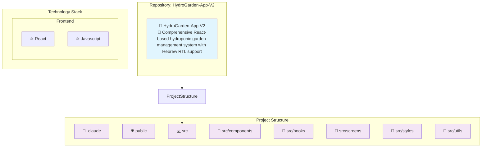

# HydroGarden-App-V2 - Architecture Diagram

🌱 Comprehensive React-based hydroponic garden management system with Hebrew RTL support

## Mermaid Diagram

## Interactive View
[View on Mermaid Live](https://mermaid.live/edit#base64:Z3JhcGggVEIKICAgICUlIEh5ZHJvR2FyZGVuLUFwcC1WMiAtIFN5c3RlbSBBcmNoaXRlY3R1cmUKICAgIHN1YmdyYXBoICJSZXBvc2l0b3J5OiBIeWRyb0dhcmRlbi1BcHAtVjIiCiAgICAgICAgUmVwb1vwn5OBIEh5ZHJvR2FyZGVuLUFwcC1WMjxici8+8J+MsSBDb21wcmVoZW5zaXZlIFJlYWN0LWJhc2VkIGh5ZHJvcG9uaWMgZ2FyZGVuIG1hbmFnZW1lbnQgc3lzdGVtIHdpdGggSGVicmV3IFJUTCBzdXBwb3J0XQogICAgZW5kCiAgICAKICAgIHN1YmdyYXBoICJQcm9qZWN0IFN0cnVjdHVyZSIKICAgICAgICBfY2xhdWRlW/Cfk4EgLmNsYXVkZV0KICAgICAgICBwdWJsaWNb8J+MkCBwdWJsaWNdCiAgICAgICAgc3JjW/Cfkrsgc3JjXQogICAgICAgIHNyY19jb21wb25lbnRzW/Cfk4Egc3JjL2NvbXBvbmVudHNdCiAgICAgICAgc3JjX2hvb2tzW/Cfk4Egc3JjL2hvb2tzXQogICAgICAgIHNyY19zY3JlZW5zW/Cfk4Egc3JjL3NjcmVlbnNdCiAgICAgICAgc3JjX3N0eWxlc1vwn5OBIHNyYy9zdHlsZXNdCiAgICAgICAgc3JjX3V0aWxzW/Cfk4Egc3JjL3V0aWxzXQogICAgZW5kCiAgICAKICAgIHN1YmdyYXBoICJUZWNobm9sb2d5IFN0YWNrIgogICAgICAgIHN1YmdyYXBoICJGcm9udGVuZCIKICAgICAgICAgICAgUmVhY3Rb4pqb77iPIFJlYWN0XQogICAgICAgICAgICBKYXZhc2NyaXB0W+Kam++4jyBKYXZhc2NyaXB0XQogICAgICAgIGVuZAogICAgZW5kCiAgICAKICAgICUlIENvbm5lY3Rpb25zCiAgICBSZXBvIC0tPiBQcm9qZWN0U3RydWN0dXJlCiAgICBQcm9qZWN0U3RydWN0dXJlIC0tPiBzcmMKCiAgICAlJSBTdHlsaW5nCiAgICBjbGFzc0RlZiByZXBvIGZpbGw6I2UxZjVmZQogICAgY2xhc3NEZWYgZm9sZGVyIGZpbGw6I2YzZTVmNQogICAgY2xhc3NEZWYgdGVjaCBmaWxsOiNlOGY1ZTgKICAgIAogICAgY2xhc3MgUmVwbyByZXBvCiAgICBjbGFzcyBfY2xhdWRlLHB1YmxpYyxzcmMsc3JjX2NvbXBvbmVudHMsc3JjX2hvb2tzLHNyY19zY3JlZW5zLHNyY19zdHlsZXMsc3JjX3V0aWxzIGZvbGRlcgo=)

## Repository Info
- **Language**: JavaScript
- **Stars**: 0
- **Forks**: 0
- **URL**: https://github.com/Meir83/HydroGarden-App-V2
